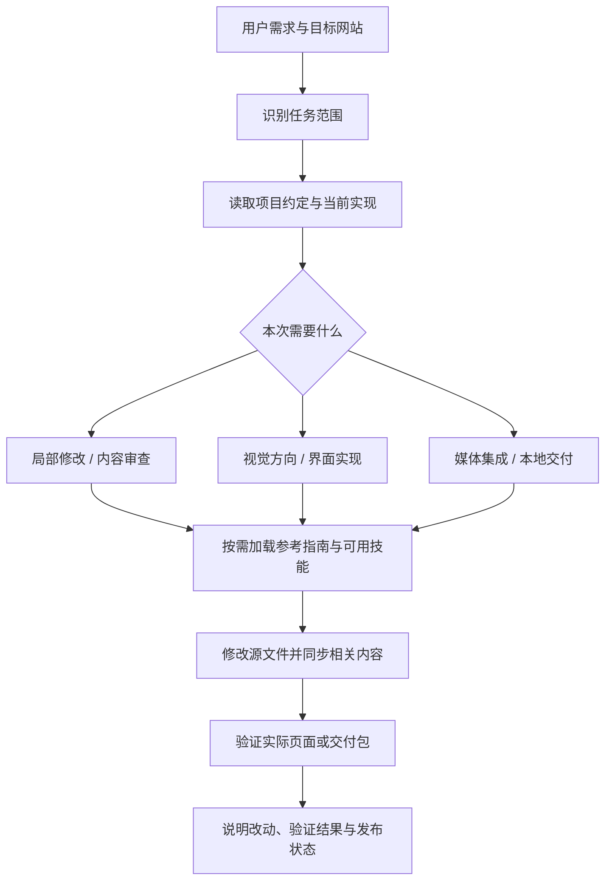

# Web Design Workflow

**面向 AI 编程助手的网页设计与交付工作流。**

把视觉设计、方案表达、交互、媒体素材和本地交付串成一套可复用的工作方式。支持新建网站，也支持日常修改：改一个标题时检查相关导航，取消视频时清理关联提示，整理部署包时核对最终资源与目录。

它通过 `SKILL.md` 向助手提供决策规则，实际文件修改和验证由助手及其可用工具完成。仓库本身没有网站运行服务，不提供模型、浏览器或生图 API。

**核心约定：修改目标位置，同时检查关联一致性；整站完善仅在明确要求时进行。**

项目仓库：[Bethxx-Skieer/Web-Editor](https://github.com/Bethxx-Skieer/Web-Editor)。仓库名称是 `Web-Editor`，安装与调用时使用技能名 `web-design-workflow`。

[快速开始](#快速开始) · [使用示例](docs/examples.md) · [技术原理](docs/architecture.md) · [配套技能](docs/integrations.md) · [发布指南](docs/publishing.md) · [验证方法](docs/validation.md)

## 适合什么场景

| 场景 | 工作流关注的结果 |
| --- | --- |
| 产品介绍页、方案页、教程入口 | 访客能理解问题、适用人群、模块关系、产出与下一步操作 |
| 新建网站或已授权的重设计 | 建立有主题特征的视觉方向，让排版、素材与交互遵循同一设计约定 |
| 标题、按钮、截图等局部修改 | 精确完成目标，检查相关导航、无障碍名称和说明，不顺便重做整站 |
| 整页内容与价值审查 | 找到含糊承诺、重复表达、错误顺序和缺失前提；按授权范围修改 |
| 图片、二维码、教程视频 | 保证信息完整、关键操作可见、播放器可用、二维码仍能识别 |
| 本地维护与交付打包 | 保持源文件、发布目录、子目录路径和交付包一致 |

后端开发、无关文档写作、独立影视制作不属于本技能的主要范围。网页中的视频增强可以转交已有视频工作流。

## 它具体改善什么

- **把“高级”变成可执行要求。** 明确层级、合理密度、完整素材和一致交互，按项目需要选择装饰与动效。
- **分清工具之间的关系。** 并行路径、可选能力、前置条件和真实执行顺序分别表达，避免强行写成连续步骤。
- **让局部修改收尾完整。** 标题变化可能影响导航；视频取消可能影响 FAQ；网页更新可能影响已有下载包。
- **保留证据。** 原始报告、截图、提示词和录屏保持可追溯；说明文案可以改进，不伪造演示结果。
- **让交付可以使用。** 检查子目录资源、交互与压缩包；区分增量内容和完整站点，清楚说明发布状态。

这些是工作规范，不是效果保证。最终质量仍取决于任务信息、模型能力、工具权限和实际验证。

## 快速开始

### 1. 准备环境

使用支持本地 skills 的 Codex 环境，并让助手能访问待编辑的网站。仅阅读这套指导无需 Node.js、Python 或 API Key；执行网页构建需要目标项目自己的环境。仓库校验脚本可选，需要 Python 3.10 或更新版本。

其他支持 Agent Skills 的助手可以参考使用，但本仓库没有完成所有客户端的兼容性测试。工具名、安装位置和权限以各客户端为准。

### 2. 安装 skill

从仓库下载 ZIP 并解压，或克隆仓库。安装的单位是 **`skills/web-design-workflow` 整个目录**，包含 `SKILL.md`、`references` 和 `agents`。

```bash
git clone https://github.com/Bethxx-Skieer/Web-Editor.git
cd Web-Editor
```

当前 Codex 官方文档列出的个人目录为 `~/.agents/skills`，项目目录为 `<项目>/.agents/skills`；同名技能不会自动合并。[官方安装与发现说明](https://learn.chatgpt.com/docs/build-skills)

Windows PowerShell，在解压后的仓库根目录执行：

```powershell
$skillParent = Join-Path $HOME '.agents/skills'
$skillTarget = Join-Path $skillParent 'web-design-workflow'
if (Test-Path -LiteralPath $skillTarget) {
    throw '已经安装同名技能，请先比较并备份现有版本。'
}
New-Item -ItemType Directory -Path $skillParent -Force | Out-Null
Copy-Item -LiteralPath './skills/web-design-workflow' -Destination $skillTarget -Recurse
```

macOS / Linux，在仓库根目录执行：

```bash
skill_parent="$HOME/.agents/skills"
skill_target="$skill_parent/web-design-workflow"
if [ -e "$skill_target" ]; then
  echo "已经安装同名技能，请先比较并备份现有版本。"
else
  mkdir -p "$skill_parent" && cp -R ./skills/web-design-workflow "$skill_target"
fi
```

团队共用时，将同一个目录放入目标仓库的 `.agents/skills/` 并纳入版本管理。已有环境若使用其他明确支持的技能目录，沿用该环境的设置；避免同时装入多个同名副本。

也可让支持该功能的 `$skill-installer` 从公开仓库安装：

```text
请使用 $skill-installer，从 https://github.com/Bethxx-Skieer/Web-Editor
安装 skills/web-design-workflow 目录下的技能。
先检查是否已有同名技能，不要覆盖我的本地改动。
```

### 3. 在网站项目中调用

```text
请使用 $web-design-workflow，优化当前网站的方案介绍页。
先读取项目的 DESIGN.md，保留现有品牌与功能。
重点说明各模块怎样配合，以及用户能得到什么。
直接修改本地文件，检查相关交互和移动端显示，只做本地交付。
```

如果客户端使用技能选择器，请选择 `web-design-workflow`。官方支持按名称显式调用，也支持根据描述自动选择；安装后未出现时可重启客户端检查。[调用方式](https://learn.chatgpt.com/docs/build-skills)

首次使用可以先让助手列出找到的技能入口和目标网站目录，确认没有误选其他项目。

### 4. 按需配套

**仅安装本技能即可执行基础工作流。** 大型设计任务可结合 `frontend-design`、`impeccable`、`hallmark`；图片、特效和视频按任务需要接入。

本仓库不自动下载这些工具，不附带第三方 skill 源码，也不提供付费服务权限。来源、分工与缺失时的处理见 [配套技能说明](docs/integrations.md)。

## 工作方式



`DESIGN.md` 用来记录项目自己的视觉与交互约定。已有网站先检查真实实现和当前设计文档；缺少文档时保留已有设计事实，不自动触发重设计。不同技能的建议都应服务于用户需求和这一共同约定。

这是由模型执行的任务分流规则，没有单独的后台调度器，也不会因为提到了多个技能就自动启动多个 Agent。

## 仓库结构

```text
web-design-workflow/
├── README.md                       使用入口
├── LICENSE                         MIT 许可证
├── THIRD_PARTY.md                   外部集成与权利边界
├── VERSION                         当前分享版版本
├── docs/
│   ├── architecture.md             技术原理、数据流、限制
│   ├── integrations.md             核心与可选技能说明
│   ├── examples.md                 可直接使用的任务示例
│   ├── publishing.md               GitHub 上传与维护指南
│   └── validation.md               结构验证与行为验收场景
├── scripts/
│   └── validate.py                 无第三方依赖的仓库结构检查
└── skills/web-design-workflow/
    ├── SKILL.md                     助手读取的主工作流
    ├── LICENSE                      随安装目录保留的 MIT 许可
    ├── agents/openai.yaml           Codex 展示与调用元数据
    └── references/
        ├── content-and-consistency.md
        ├── media-and-evidence.md
        └── local-delivery.md
```

README 与 `docs` 面向使用者和维护者。执行任务时，助手从 `SKILL.md` 进入，只读取当前任务需要的参考指南。

## 常见问题

**需要一次安装所有设计技能吗？**

不需要。基础流程独立可用；配套技能负责更深入的专业工作。缺少生成或渲染能力时，应明确说明限制，不能假装完成。

**会把项目改成固定的技术栈或风格吗？**

不会。沿用目标项目的 HTML/CSS/JavaScript 或已有框架、构建方式及设计约定。玻璃、渐变、3D 等效果由需求决定。

**会强制使用托管建站服务吗？**

不会。用户要求本地维护时直接修改本地源文件，已经选定的部署方式继续沿用。

**安装后能自动生成图片和视频吗？**

安装只提供工作方法。生成、编辑、渲染需要当前环境实际可用的工具、账户权限与运行环境，可能产生相应服务费用。

**这就是一个能在线访问的网站吗？**

这是技能仓库。上传到 GitHub 后，别人可以阅读、下载并安装；网站本身由他们在自己的项目中使用助手来制作。GitHub Pages 和网站部署不是使用此 skill 的必要条件。

**怎么避免复制或下载旧的生成结果？**

内容指南要求追踪输入修改、用途切换、生成、复制和下载之间的状态。根据现有交互选择自动更新或明确标记待更新，验证输出与当前输入一致。

**能保证所有修改都正确吗？**

不能。结构校验不等于页面质量验证，也不能证明模型每次都遵循规则。真实浏览器、媒体、打包和场景检查仍然必要。

## 维护与贡献

在仓库根目录运行：

```bash
python scripts/validate.py
```

提出改进时，请附上最小可复现场景、目标行为、实际行为和验证结果；不要提交账户信息或私人项目素材。优先修正已观察到的问题，避免为单个案例增加全局强制流程。详见 [验证与贡献说明](docs/validation.md)。

## 许可

本仓库原创的工作流、文档和校验脚本采用 [MIT License](LICENSE)。外部工具、配套技能及使用者提供的素材遵循各自的许可，见 [第三方说明](THIRD_PARTY.md)。

当前版本为 `0.1.0`，主攻 Codex 使用流程；未捆绑模型服务、插件服务端或第三方依赖。
